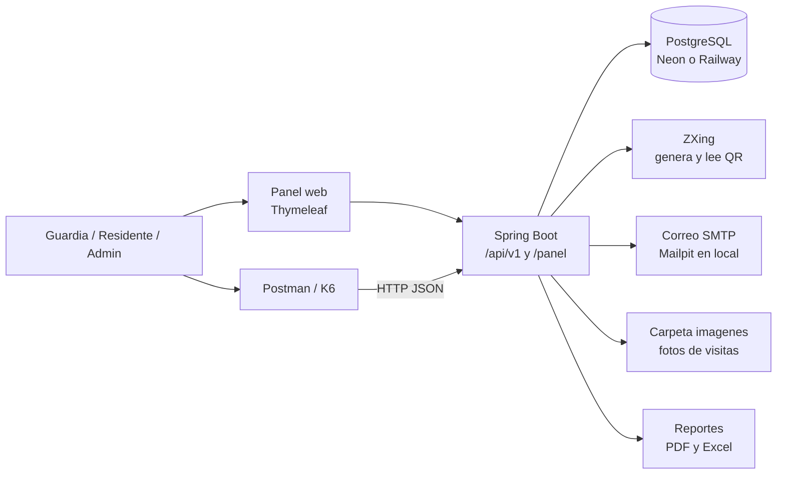
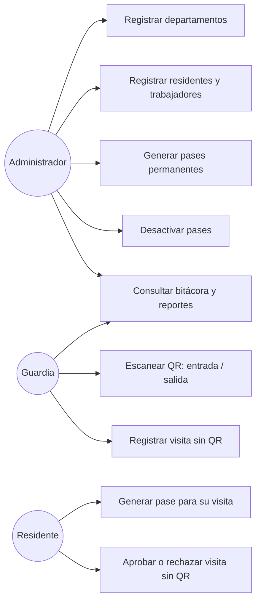
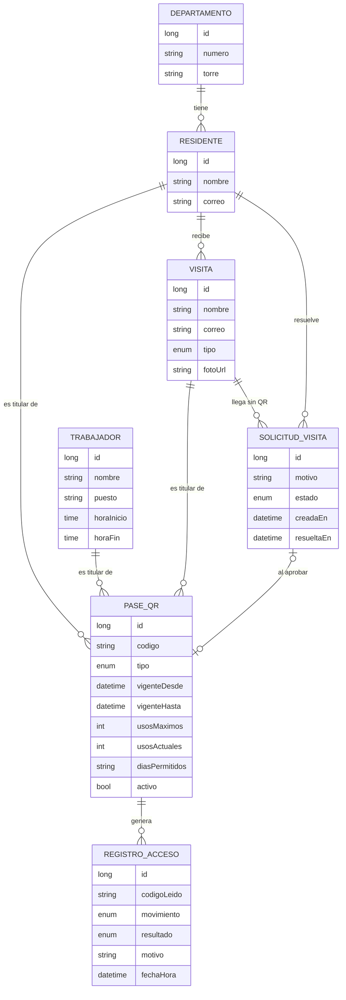

# Control de acceso con QR para condominios

Proyecto final. API REST en **Spring Boot** para controlar la entrada y salida de residentes,
trabajadores y visitas de un condominio con pases QR.

# Integrantes de BlackWatch 
-Aguirre Rivera Uriel Jefté
-Rivera Rodriguez Jesus Armando

## Qué hace

- Registra departamentos, residentes y trabajadores (con horario permitido).
- Genera un pase QR para cada residente y trabajador, y pases temporales para visitas
  (únicos o recurrentes, con vigencia y días permitidos).
- Regresa la **imagen PNG del QR** de cada pase (ZXing).
- El guardia escanea el QR **con la cámara** (webcam o celular, en JavaScript), escribiendo el código o subiendo **la foto del QR**, y el sistema registra la **entrada o salida** (PERMITIDO / DENEGADO + motivo).
- Visitas sin QR: el guardia las registra **con foto** (se guarda en la carpeta `imagenes`) y el residente aprueba o rechaza. Al aprobar se genera un pase de un solo uso.
- **Correo al residente** (plantilla HTML) cuando llega una visita sin QR y cuando su visita entra con su pase.
- **Reportes de la bitácora en PDF y Excel.**
- Bitácora de accesos.
- **Panel web** (Thymeleaf) con inicio, residentes, pases QR, caseta del guardia, visitas y bitácora.

## Diagramas

### 1. Componentes



### 2. Casos de uso por rol



### 3. Modelo de datos



## Cómo correrlo

### Opción 1: todo con Docker (recomendada)

Solo necesitas Docker Desktop abierto.

```cmd
docker compose up --build
```

Esto levanta Postgres, el API y **Mailpit** (buzón de correo de prueba). Al arrancar se cargan datos de ejemplo (3 departamentos, 2 residentes y 1 trabajador con sus pases).

- Panel web: http://localhost:8080/panel
- Correos que manda el sistema: http://localhost:8025
- Fotos subidas: carpeta `imagenes/` del proyecto
- Swagger: http://localhost:8080/swagger-ui.html
- Salud del servidor: http://localhost:8080/actuator/health

Para apagarlo: `docker compose down` (con `-v` también se borra la base).

### Opción 2: Maven + Postgres en Docker

```cmd
docker compose up -d db
mvn spring-boot:run
```

### Opción 3: con la base de Neon

Copia `src/main/resources/local.properties.example` como `local.properties` y pon la URL, usuario y contraseña de Neon. Ese archivo no se sube a GitHub.

### Variables de entorno

| Variable | Para qué | Valor por defecto |
|---|---|---|
| `DB_URL` | URL JDBC de Postgres | `jdbc:postgresql://localhost:5432/condominios` |
| `DB_USER` | Usuario | `postgres` |
| `DB_PASSWORD` | Contraseña | `postgres` |
| `PORT` | Puerto del API | `8080` |
| `DATOS_SEMILLA` | Cargar datos de ejemplo | `true` |
| `CARPETA_IMAGENES` | Carpeta donde se guardan las fotos | `imagenes` |
| `CORREO_ACTIVO` | Mandar correos (si es `false` solo se escriben en el log) | `false` |
| `MAIL_HOST`, `MAIL_PORT` | Servidor de correo | `localhost`, `1025` |
| `MAIL_USER`, `MAIL_PASSWORD`, `MAIL_AUTH`, `MAIL_TLS` | Para un correo real (por ejemplo Gmail) | vacíos |
| `URL_PANEL` | Dirección del panel que va en los correos | `http://localhost:8080` |

Para mandar correos reales con Gmail: `MAIL_HOST=smtp.gmail.com`, `MAIL_PORT=587`, `MAIL_AUTH=true`, `MAIL_TLS=true`,
`MAIL_USER=tu correo` y `MAIL_PASSWORD=` una *contraseña de aplicación* de Google.

### Escanear con el celular

La cámara del navegador solo funciona en `https` o en `localhost`. En la compu basta con `http://localhost:8080/panel/escanear`.
En el celular se usa la versión de Railway (ya trae https). Para probar en la red local sin https, en Chrome del celular
se puede abrir `chrome://flags`, buscar **Insecure origins treated as secure** y agregar `http://IP-DE-LA-COMPU:8080`.

## Despliegue en Railway

1. Entra a [railway.app](https://railway.app) con tu cuenta de GitHub.
2. **New Project → Deploy from GitHub repo** y elige este repositorio. Railway detecta el `Dockerfile` solo.
3. En el mismo proyecto: **+ New → Database → PostgreSQL**.
4. En el servicio del API, pestaña **Variables**, agrega:
   ```
   DB_URL=jdbc:postgresql://${{Postgres.PGHOST}}:${{Postgres.PGPORT}}/${{Postgres.PGDATABASE}}
   DB_USER=${{Postgres.PGUSER}}
   DB_PASSWORD=${{Postgres.PGPASSWORD}}
   ```
   (Si se usa Neon en lugar del Postgres de Railway, aquí van los datos de Neon con `?sslmode=require` al final de la URL).
5. **Settings → Networking → Generate Domain** para tener la URL pública.
6. Revisar que responda: `https://TU-APP.up.railway.app/actuator/health`.

Cada `git push` a `main` vuelve a desplegar.

## Endpoints

Todos empiezan con `/api/v1`. La lista completa con ejemplos está en Swagger.

| Método | Ruta | Descripción |
|---|---|---|
| POST / GET | `/departamentos` | Alta y listado |
| POST / GET | `/residentes` | Alta y listado (`GET /residentes/{id}`) |
| POST / GET | `/trabajadores` | Alta y listado |
| POST | `/pases/residente/{id}` | Pase permanente de residente |
| POST | `/pases/trabajador/{id}` | Pase permanente de trabajador |
| POST | `/pases/visita` | Pase temporal de visita |
| GET | `/pases`, `/pases/{id}` | Lista y detalle de pases |
| GET | `/pases/{id}/qr` | Imagen PNG del QR |
| PUT | `/pases/{id}/desactivar` | Desactiva un pase |
| POST | `/accesos/validar` | Escanea un QR (`{"codigo": "..."}`) |
| POST | `/accesos/validar-imagen` | Escanea la foto del QR (form-data, campo `imagen`) |
| GET | `/accesos` | Bitácora de accesos |
| POST | `/accesos/visita-sin-qr` | Guardia registra visita sin QR |
| GET | `/solicitudes?estado=PENDIENTE` | Solicitudes de visitas |
| POST | `/archivos/fotos` | Sube la foto de una visita (form-data, campo `foto`) |
| GET | `/reportes/bitacora.pdf` | Bitácora en PDF |
| GET | `/reportes/bitacora.xlsx` | Bitácora en Excel |
| PUT | `/solicitudes/{id}/resolver` | Residente aprueba o rechaza (`{"aprobada": true}`) |

## Pruebas

Están en la carpeta `pruebas/`. Los reportes HTML se guardan en `pruebas/reportes/`.

### Postman

La colección `pruebas/postman/condominios.postman_collection.json` tiene 37 peticiones en 7 carpetas
(salud, registro, pases, accesos, visita sin QR, errores, y fotos y reportes), cada una con sus tests.
Se corre completa en orden porque cada petición guarda datos para la siguiente.

- En Postman: **Import** la colección y el entorno `local`, luego **Run collection**.
- Con newman (reporte HTML):
  ```cmd
  cd pruebas
  npm install
  npm run postman
  ```

### K6 (carga)

Simula hasta 50 guardias escaneando QR al mismo tiempo durante 80 segundos.

```cmd
winget install k6
cd pruebas
k6 run k6/carga.js
k6 run -e BASE_URL=https://TU-APP.up.railway.app k6/carga.js
```

## Estructura

```
src/main/java/com/condominios/acceso
├── config       # datos de ejemplo, CORS y Swagger
├── controller   # endpoints REST (/api/v1)
├── web          # pantallas del panel (@Controller + plantillas)
├── service      # reglas de negocio (validación del QR, solicitudes, ZXing)
├── repository   # acceso a datos (Spring Data JPA)
├── entity       # entidades y enums
├── dto          # objetos de entrada y salida
└── exception    # errores y manejador global
pruebas/
├── postman      # colección y entornos
├── k6           # prueba de carga
└── reportes     # reportes HTML generados
```

## Pendiente

Login con JWT y roles, tablas de catálogo, correo al residente, reportes PDF/Excel de la bitácora,
almacén de archivos (fotos de identificación), idempotencia, webhook,
tarea programada y consumo de un servicio externo.
